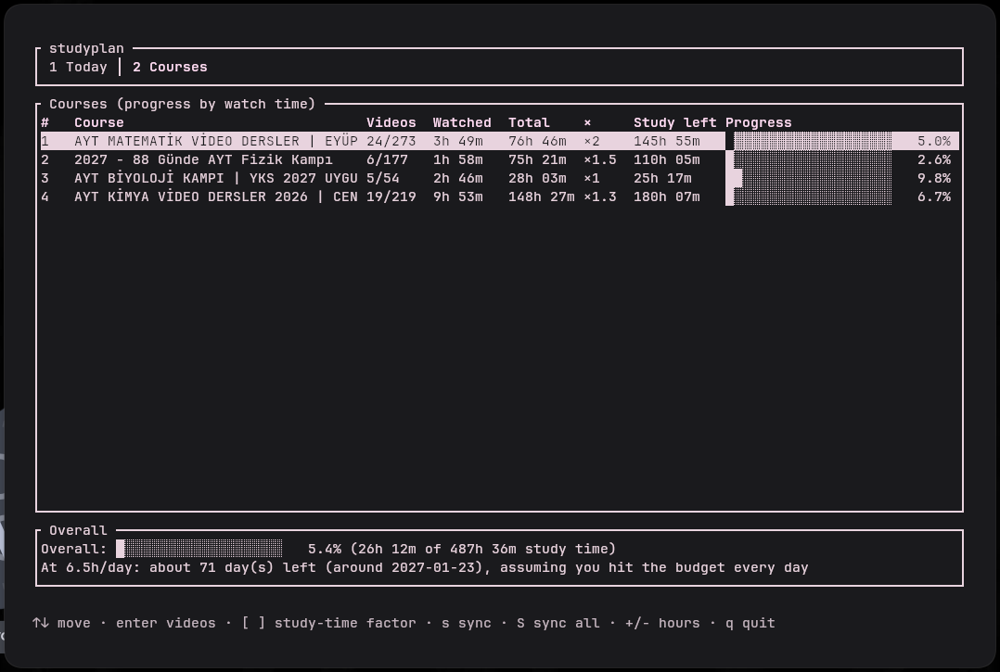

# studyplan

Track YouTube course playlists, set how many hours you study per day, and get a
daily to-do list of videos that fit that budget — with a terminal UI showing
progress per course.

<p align="center">
  
</p>

## Requirements

- Rust (edition 2024, i.e. Rust 1.85+)
- [`yt-dlp`](https://github.com/yt-dlp/yt-dlp) in your `PATH` (used to read playlist
  titles and video lengths; no API key needed)

## Build

```sh
cargo build --release
# binary: target/release/studyplan
```

## Usage

```sh
studyplan add "https://www.youtube.com/playlist?list=..." [--name "My course"] [--watched 1-12,15]
studyplan videos <course>                # numbered video list with watched state
studyplan mark <course> 1-12,15          # mark videos you already watched (or: all)
studyplan mark <course> 5-7 --undo       # unmark
studyplan factor <course> 2              # videos of this course take 2x their length (maths)
                                         # also: add ... --factor 2
studyplan config --hours 2.5 --mode interleave   # interleave is the default; or: sequential
studyplan                # open the terminal UI (same as `studyplan tui`)
studyplan today          # print today's to-do list
studyplan done 1 2       # mark items of today's list as watched
studyplan undone 2
studyplan list           # courses with progress and an ETA
studyplan sync [course]  # pick up videos added to / removed from playlists
studyplan remove <course>
```

`<course>` is its number from `studyplan list` or part of its name.

### Terminal UI keys

| Key | Action |
| --- | --- |
| `↑↓` / `j k` | move |
| `space` / `enter` | toggle watched (Today tab) |
| `r` | re-plan today |
| `+` / `-` | change daily budget by 0.5 h |
| `s` / `S` | sync selected course (Courses tab) / sync all |
| `enter` | Courses tab: open the course's video list |
| `space` | video list: toggle watched |
| `m` / `u` | video list: mark everything up to here as watched / unmark from here to the end |
| `esc` | video list: back |
| `[` / `]` | Courses tab: lower / raise the selected course's study-time factor by 0.25 |
| `tab`, `1`, `2` | switch tab |
| `q` / `esc` | quit |

## How the plan is built

- Videos are taken in playlist order within each course.
- A video is added only if it fits in the remaining time of today's budget.
  Exception: if nothing is planned yet, the next video is added even if it is
  longer than the whole budget, so a long lecture can never block a course.
- `interleave` mode (default): one video from each course in turn, starting with the
  course you have finished the least, so no course is starved when the budget is small.
  `sequential` mode (opt-in): course 1 first, leftover time goes to course 2, etc.
- Videos marked as already watched (`mark`, `add --watched`, or the video list in the
  TUI) are skipped and count as watched earlier, not toward today's progress. To count
  a video toward today, tick it on the Today tab instead.
- Each course has a **study-time factor** (default 1). A video costs `length × factor`
  of your daily budget, so with factor 2 a 30-minute math video uses 60 minutes.
  The Today list shows both (`30:00 → 1h 00m`), and the finish-date estimate and the
  overall progress bar use study time. Per-course percentages stay based on video length.
- Today's list is stored, so it does not change while you tick videos off.
  A new list is built on the first run of a new day; unwatched videos come up
  again. `r` / `today --refresh` re-plans the unwatched part.
- Progress percentages are weighted by video length, not video count.

## Arch Linux (AUR)

The [`studyplan-git`](https://aur.archlinux.org/packages/studyplan-git) package
builds the latest git revision:

```sh
yay -S studyplan-git        # or: paru -S studyplan-git
```

It installs `/usr/bin/studyplan`, the README and the MIT license, and pulls in
`yt-dlp`. Uninstall with `sudo pacman -R studyplan-git`; data in
`~/.local/share/studyplan/` is left in place. The packaging files in
`packaging/arch/` are licensed under 0BSD.

## Data

State is one JSON file (`~/.local/share/studyplan/state.json` on Linux).
Set `STUDYPLAN_DATA=/path/to/file.json` to use another location.

## Tests

```sh
cargo test
```
